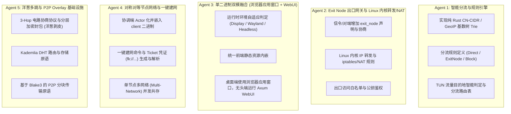

# fuckipv6 下一代系统演进与子 Agent 并行开发规划 (NEXTGEN_TODO.md)

## 总体架构目标
目标是将 `fuckipv6` 从基础 P2P 虚拟局域网演进为：**具备原生智能分流/Exit Node 能力、单一二进制自适应浏览器 WebUI、节点完全对称（既是客户端也是服务端）、具备 3-Hop 洋葱多跳与 P2P Overlay 基础设施的下一代去中心化网络系统**。以下清单表示目标与当前成熟度，不表示所有能力均已产品化。

---

## 5 大子 Agent 并行开工任务分工表

---

## 任务执行清单与开发规范

### 能力状态口径

- **可直接使用**：已有真实运行时控制链路、自动化测试或可复现验证，用户可通过 CLI/WebUI 操作。
- **基础设施已接入（待产品化）**：协议、数据结构或引擎已接入并有测试，但缺少完整用户入口、运维闭环或目标平台验证。
- **尚未产品化**：仅存在于目标设计或原型验证，不能作为当前可用功能对外承诺。

### 🟢 Agent 1 任务清单：智能分流与规则引擎 ✅ **可直接使用**
- [x] **1.1** 在 `crates/common/src/routing.rs` 定义路由规则结构：
  - `RoutingAction`: `Direct`（直连）、`Proxy`（走指定 ExitNode）、`Mesh`（对等内网）、`Reject`（阻断）。
  - `RoutingMode`: `MeshOnly`、`BypassMainland`（绕过大陆）、`GlobalProxy`（全局代理）。
  - `RoutingConfig` & `ExitNodeConfig`: 结构化配置。
- [x] **1.2** 在 `crates/common/src/routing.rs` 实现高性能嵌入式纯 Rust CN-CIDR 快速匹配 Trie（支持三大运营商 IPv4/IPv6 聚合网段，零外部依赖）。
- [x] **1.3** 改造 TUN 读取包处理流程：当捕获非虚拟内网目标 IP（如访问公网）时，根据规则决定直接由本地物理网卡发送还是封装后投递至 Exit Node。
- [x] **1.4** 添加单元测试：覆盖 IPv4/IPv6 大陆 IP 命中、海外 IP 走 Proxy、内网虚拟 IP 走 Mesh 的完整测试用例。

### 🟢 Agent 2 任务清单：Exit Node 出口网关与 Linux 内核转发/NAT ✅ **Linux 可直接使用；其他平台待验证**
- [x] **2.1** 在 `crates/common/src/config.rs` 中为 `ClientConfig` 扩展 `routing` 与 `exit_node` 声明。
- [x] **2.2** 在 `crates/client/src/routing/exit_node.rs` 实现出口网关管理器 `ExitNodeManager`：支持按虚拟 IPv6、虚拟 IPv4 及 ClientId 动态匹配出口节点，并实施客户端公钥指纹白名单鉴权。
- [x] **2.3** 在 Linux 上安装并维护内核 IP 转发、策略路由及 iptables/NAT 规则；未实现纯用户态 NAT。
- [x] **2.4** 历史验证：在境外服务器 `relay.xlei.cc` 启用 Exit Node、内核 IP 转发与 MASQUERADE NAT 规则并运行；该结果不是本仓库可重复自动验证的测试。
- [ ] **2.5** 产品化：补充 Windows/macOS 等价能力验证、可观测性、失败回滚和跨主机自动化测试。

### 🟢 Agent 3 任务清单：单一二进制自适应双模 (浏览器应用窗口 + WebUI) ✅ **可直接使用**
- [x] **3.1** 运行期自适应环境检测：
  - 启动时检测参数（`--headless` / `--gui`）。
  - 未指定时自动检测操作系统显示环境：Linux 下检测 `DISPLAY` 与 `WAYLAND_DISPLAY` 环境变量；Windows/macOS 检测交互式桌面会话。
- [x] **3.2** 统一前端资产打包与双向暴露：
  - 无头环境或服务器端自动启动内置 Axum WebUI（默认 `8080` 端口，可通过 `--webui-port` 指定），提供现代可视化实时仪表盘。
  - 桌面环境通过 Chromium 系浏览器 `--app` 独立窗口打开 WebUI，失败时降级为系统默认浏览器；仓库当前没有 Tauri 依赖，也没有 Tauri 原生窗口。
  - 节点 WebUI/API 默认只监听 `127.0.0.1`（可用 `FUCKIPV6_WEBUI_BIND=::1` 选择 IPv6 回环）；非回环监听必须显式设置危险开关和认证，否则拒绝启动。远程使用仍需 TLS 反向代理或受控管理网。
- [x] **3.3** REST API 与实时状态控制打通：
  - `GET /api/status`：提供节点双栈虚拟 IP、运行状态、当前分流模式、出口节点。
  - `GET /api/peers`：实时展示对等节点、延迟及连接链路类型（直连/中继）。
  - `POST /api/routing`：零停机热切换分流策略（`MeshOnly` / `BypassMainland` / `GlobalProxy`）与出口节点。

### 🟢 Agent 4 任务清单：对称对等节点网络与一键建网 ✅ **已完成**
- [x] **4.1** 融合架构改造：
  - 提炼协调服务端与 QUIC 中继为轻量内嵌式 `EmbeddedCoordinator` Actor，消除循环依赖，赋能客户端进程直接建网。
- [x] **4.2** 一键建网与 Ticket 协议：
  - 新增命令 `fuckipv6 host --name <NAME>`：本地初始化虚拟网络，自动生成 `fk://<pubkey>@<host:port>?name=<NAME>&v6=...` 邀请凭证，并支持本机自动连接。
  - 新增命令 `fuckipv6 join <Ticket>`：原生自动识别与解析 `fk://` 邀请凭证，自动配置协调服务连接与默认网络。
- [x] **4.3** 多网络并发支持：单个客户端实例可维护多个网络配置与虚拟通道，根据网络名称派生独立 TUN 接口（`fk-<net_name>`），实现内核级路由隔离、P2P 会话隔离与统一 IPC/WebUI 状态聚合。

### 🚧 Agent 5 任务清单：洋葱多跳与 P2P Overlay 基础设施 🚧 **基础设施已接入，待产品化**
- [x] **5.1** 洋葱电路协商协议：
  - 在 `crates/common/src/onion.rs` 实现 3-Hop 多层嵌套密钥协商协议。
  - 发送端采用多层 ChaCha20-Poly1305 进行洋葱封包，每个中继节点仅解密自己一层并获取下一跳路由；当前提供电路与转发原语，尚未形成完整用户操作流程。
- [x] **5.2** Kademlia 分布式哈希表（DHT）：
  - 实现 256-bit XOR 空间、K-Buckets、LRU 缓存与 TTL 回收等 DHT 路由和存储原语；尚未替代 Coordinator 成为默认用户发现流程。
- [x] **5.3** P2P 加密消息与内容分块传输：
  - 基于 Blake3 实现分块哈希、分块组装与传输原语；完整的文件发布、浏览、下载和多源调度尚未产品化。
  - 基于节点公钥地址实现端到端加密的点对点消息推送（临时 X25519 前向安全、Ed25519 签名与防篡改验证）。
  - 在客户端引擎集成 `P2pOverlay` 统一调度信元解密分发，并覆盖分块组装与 DHT 存储单元测试。
- [ ] **5.4** 产品化入口：提供创建/关闭洋葱电路、DHT 查询和文件发布/拉取的可操作 CLI/WebUI 流程及端到端集成测试。

---

## 开发质量红线与要求
1. **100% 独立自主**：绝不依赖外部黑盒二进制、脚本或运行时动态下载 DLL。
2. **全平台编译兼容**：任何代码变更必须保证 Linux musl (`x86_64-unknown-linux-musl`) 与 Windows GNU (`x86_64-pc-windows-gnu`) 均编译无报错。
3. **严格质量门禁**：`cargo check --workspace`、`cargo clippy --workspace --all-targets -- -D warnings` 与 `cargo test --workspace` 必须 100% 通过。
